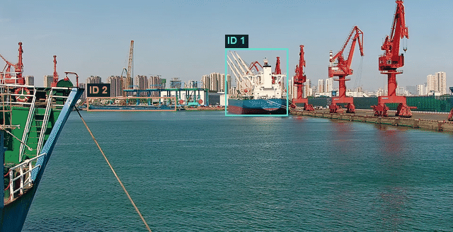

# TugPercept Dataset

TugPercept is a custom, self-collected maritime visual object tracking dataset designed for research on vessel detection, object association, and continuous tracking in harbor environments.

**We currently release only a subset of the full dataset, consisting of 8 video sequences and 4,800 frames, available through the Baidu Netdisk link below. To request access to the full dataset, please contact the authors by email.**

## Paper and Contact

- **Paper title:** [TO BE FILLED: Full paper title]
- **Paper link / DOI:** [TO BE FILLED: Paper URL or DOI]
- **Contact email:** `chenxinqiang@stu.shmtu.edu.cn`

## Dataset Previews

**Tugboat Turning**


**Harbor Vessels**



**Multi-Vessel Tracking**


## Dataset Download and Full Dataset Access

### Public Subset

The publicly available download contains **8 video sequences**, representing a subset of the full dataset.

- **Baidu Netdisk:** [Download the public subset]([https://pan.baidu.com/s/BAIDU_SHARE_ID](https://pan.baidu.com/s/1bPHBLqTPSehsp9P8tBZAiw?pwd=n9pu))
- **Access code:** ` n9pu`

### Full Dataset

**To request access to the full dataset, please email chenxinqiang@stu.shmtu.edu.cn**

## Citation

If you find this dataset useful for your research, please cite the associated paper. Replace the placeholders below with the actual publication details before use.

```bibtex
@misc{tugpercept,
  author       = {AUTHOR_NAMES},
  title        = {PAPER_TITLE},
  year         = {YEAR},
  howpublished = {DATASET_REPOSITORY_URL},
  note         = {TugPercept maritime tracking dataset}
}
```
