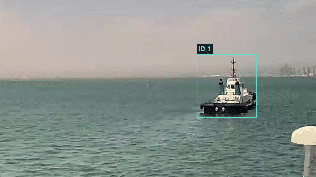
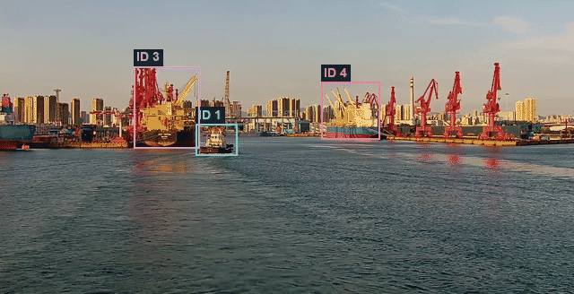

# TugPercept Dataset

TugPercept 是一份自采、自建的海事视觉目标追踪数据集，面向港区环境下的船舶检测、目标关联与连续追踪研究。数据包含拖轮、大型运输船舶等目标，以及尺度变化、转向、遮挡和复杂港区背景等情况。

**目前我们仅公开完整数据集的一部分，即下方百度网盘链接中的 8 段视频序列，共 4,800 帧。如需申请获取完整数据集，请通过邮箱联系作者。**

## 论文与作者

- **论文标题：** [待填写：论文完整标题]
- **论文链接 / DOI：** [待填写：论文地址或 DOI]
- **联系邮箱：** `YOUR_EMAIL@example.com`（待替换）

## 数据预览

### 图像与标注示例


### 动态预览

**拖轮转向**



**港区船舶**


**多船目标追踪 **



## 数据下载与完整数据申请

### 公开子集

目前公开的下载内容仅包含 **8 段序列**，并非完整数据集。

- **百度网盘链接：** [点击下载公开子集](https://pan.baidu.com/s/BAIDU_SHARE_ID)
- **提取码：** `BAIDU_ACCESS_CODE`
- **公开版本：** [待填写：版本号]
- **更新日期：** [待填写：实际发布日期]
- **下载包内容：** [待填写：图片与标注的压缩包名称，并确认已同时包含原始 JPEG、对应版本 GT 和序列元数据]
### 完整数据集

**如需申请获取完整数据集，请发送邮件至 [YOUR_EMAIL@example.com](mailto:YOUR_EMAIL@example.com)。**

建议邮件主题为：`TugPercept 完整数据集申请`，并简要说明：

- 姓名及所属机构；
- 研究方向或项目背景；
- 数据集的预期用途。

作者将通过邮件回复访问方式及适用条款。完整数据集的申请入口不代表其已在网盘中公开提供。

## 引用

如果本数据集对您的研究有帮助，请引用相关论文。以下为待填写模板，正式使用前请替换为论文的真实信息：

```bibtex
@misc{tugpercept,
  author       = {AUTHOR_NAMES},
  title        = {PAPER_TITLE},
  year         = {YEAR},
  howpublished = {DATASET_REPOSITORY_URL},
  note         = {TugPercept maritime tracking dataset}
}
```
